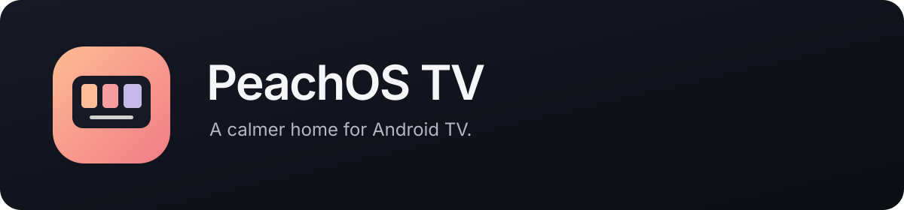
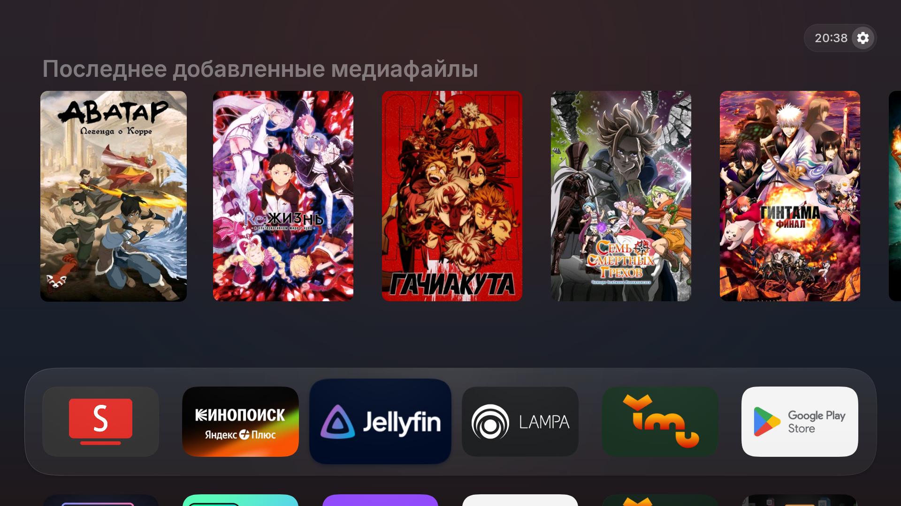
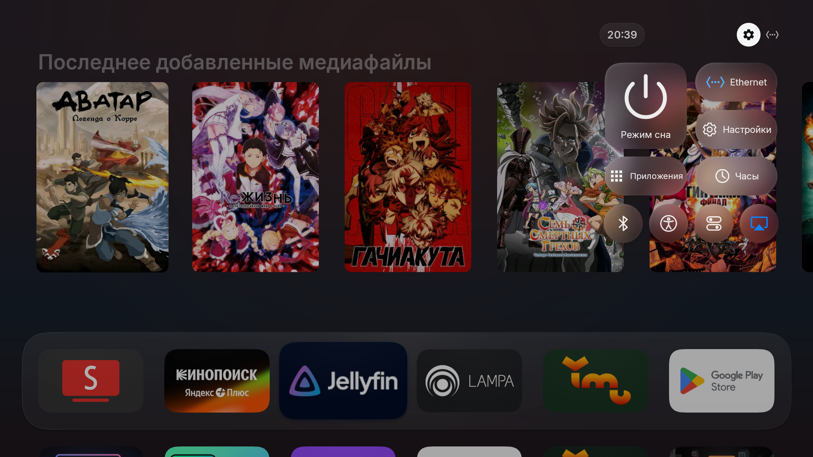

# PeachOS TV

A home screen for Android TV and Google TV, with an app dock, posters and a compact control center.

**[Download the Windows installer](https://github.com/BrainDeLook/peachos-tv/releases/latest/download/PeachOS-TV-Setup-Portable.exe)** · [Русский](README.ru.md) · [What's new](CHANGELOG.md)

Requires an **Android TV / Google TV device running Android 8.0 or newer**. Samsung Tizen and LG webOS are not supported.

## Install from a PC — recommended

1. Open the installer on Windows. It is portable: the launcher and ADB are already included.
2. On the TV, open **Settings → System / About** and select **Build** seven times. Then enable **USB / ADB debugging** in **Developer options**. Names vary by device.
3. Connect the PC and TV to the same network. Enter the TV's IP address from its network settings and select **Подключиться (Connect)**. Approve debugging on the TV.
4. Choose launcher installation and Home-button setup. Select **Проверить план (Review plan)**, then **Применить план (Apply plan)**.
5. Press Home on the remote and check that your apps open.

**Cleanup and AirPlay are optional and off by default.** Installing the launcher does not require disabling anything.

**Updating:** run the wizard again and install over your existing version. Do not uninstall PeachOS if you want to keep your settings.

If Home still opens the stock screen, use compatible Home setup in the [advanced wizard](tools/pc-setup/README.ru.md#открытие-по-кнопке-home). The Windows wizard currently uses Russian labels.

Without a PC: install the APK only

Download [PeachOS-TV.apk](https://github.com/BrainDeLook/peachos-tv/releases/latest/download/PeachOS-TV.apk), install it on your TV and open PeachOS TV. Select it as the default home screen in Android settings if your firmware allows it. The APK does not include cleanup or the AirPlay module; use the PC wizard for compatible Home setup.

To update, install the new APK over the existing app without uninstalling it.

## Features

- An app dock with adjustable order and size.
- Posters, continue watching and history from channels published by your apps.
- A control center with settings, network and TV inputs when available.
- Smooth focus, glass and sounds; effects can be disabled in settings.

View the control panel and HDMI picker

## Controls

| Action | How |
| --- | --- |
| Select an app or poster | Remote arrow buttons |
| Open / go back | OK / Back |
| Move from the dock to posters | Up |
| Edit app order or dock | Hold OK on an app |
| Open the control center | OK on the gear beside the clock |
| Open launcher settings | Launcher-settings button inside the panel |

Settings-button hold is optional. Enable it in launcher settings and grant access to **PeachOS TV · Remote buttons**. [Remote setup, posters and troubleshooting](docs/usage.md).

**AirPlay from iPhone** can be added through the installer. It is an optional experimental module: [instructions and limitations](docs/airplay-prototype.md).

[Installer and recovery guide](tools/pc-setup/README.ru.md) · [Build from source](docs/build.md)

Based on [CleanYourTV](https://github.com/Gathin23/cleanyourtv) and [Vibe Launcher](https://github.com/maydings/vibe-launcher). The launcher is [MIT licensed](LICENSE). [Credits and resource licenses](docs/credits.md).
