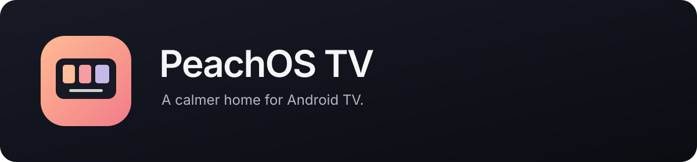
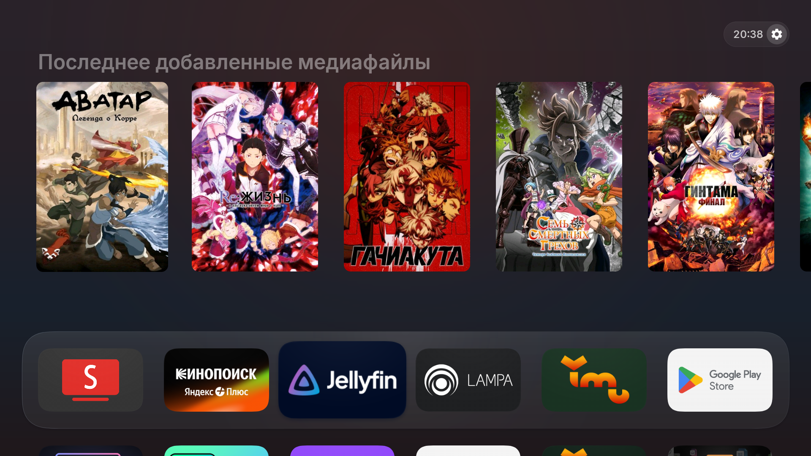
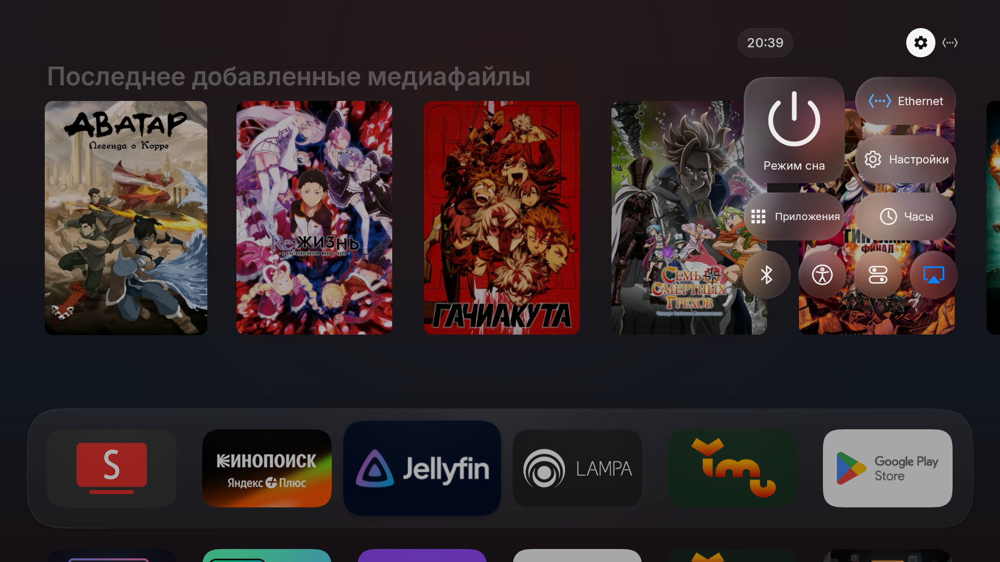

# PeachOS TV

Удобный главный экран для Android TV и Google TV: приложения в доке, постеры и компактная панель управления.

**[Скачать установщик для Windows](https://github.com/BrainDeLook/peachos-tv/releases/latest/download/PeachOS-TV-Setup-Portable.exe)** · [English](README.md) · [Что нового](CHANGELOG.md)

Нужен телевизор или приставка с **Android TV / Google TV 8.0 или новее**. Samsung Tizen и LG webOS не поддерживаются.

## Установка с ПК — рекомендуем

1. Откройте установщик на Windows. Устанавливать его на ПК не нужно: лаунчер и ADB уже внутри.
2. На телевизоре откройте **Настройки → Система / Об устройстве** и нажмите **«Сборка»** семь раз. Затем в разделе **«Для разработчиков»** включите **отладку USB / ADB**. Названия пунктов могут отличаться.
3. Подключите ПК и телевизор к одной сети. Введите в установщике IP-адрес телевизора из его настроек сети и нажмите **«Подключиться»**. Разрешите отладку на экране ТВ.
4. Выберите установку лаунчера и настройку кнопки Home. Нажмите **«Проверить план»**, затем **«Применить план»**.
5. Нажмите Home на пульте и проверьте запуск приложений.

**Очистка и AirPlay необязательны и по умолчанию выключены.** Для обычной установки ничего отключать не нужно.

**Обновление:** снова запустите мастер и установите новую версию поверх старой. Не удаляйте PeachOS — так сохранятся настройки.

Если Home открывает штатный экран, воспользуйтесь настройкой совместимого Home в [расширенном мастере](tools/pc-setup/README.ru.md#открытие-по-кнопке-home).

Без ПК: установить только APK

Скачайте [PeachOS-TV.apk](https://github.com/BrainDeLook/peachos-tv/releases/latest/download/PeachOS-TV.apk), установите его на телевизор и откройте PeachOS TV. Выберите его главным экраном в настройках Android, если прошивка это позволяет. APK не содержит очистку и модуль AirPlay; для обхода ограничений Home используйте мастер на ПК.

Для обновления установите новый APK поверх старого, без удаления приложения.

## Что умеет

- Док приложений с настройкой порядка и размера.
- Постеры, продолжение просмотра и история — из каналов, которые публикуют ваши приложения.
- Панель с настройками, сетью и HDMI-входами, если они есть у телевизора.
- Плавное выделение, стекло и звуки; эффекты можно отключить в настройках.

Посмотреть панель и выбор HDMI

## Управление

| Действие | Как сделать |
| --- | --- |
| Выбрать приложение или постер | Стрелки на пульте |
| Открыть / вернуться | OK / Назад |
| Перейти из дока к постерам | Вверх |
| Изменить порядок или док | Удерживать OK на приложении |
| Открыть панель управления | OK на шестерёнке у часов |
| Открыть настройки лаунчера | Кнопка настроек лаунчера внутри панели |

Панель по удержанию Settings включается отдельно в настройках лаунчера и требует разрешения службы **«PeachOS TV · Кнопки пульта»**. [Пульт, постеры и решение проблем](docs/usage.ru.md).

**AirPlay с iPhone** можно добавить через установщик. Это необязательный пробный модуль: [как пользоваться и ограничения](docs/airplay-prototype.md).

[Подробно об установщике и восстановлении](tools/pc-setup/README.ru.md) · [Сборка из исходников](docs/build.md)

Основа — [CleanYourTV](https://github.com/Gathin23/cleanyourtv) и [Vibe Launcher](https://github.com/maydings/vibe-launcher). Лаунчер распространяется под [MIT](LICENSE). [Авторы и лицензии ресурсов](docs/credits.md).
