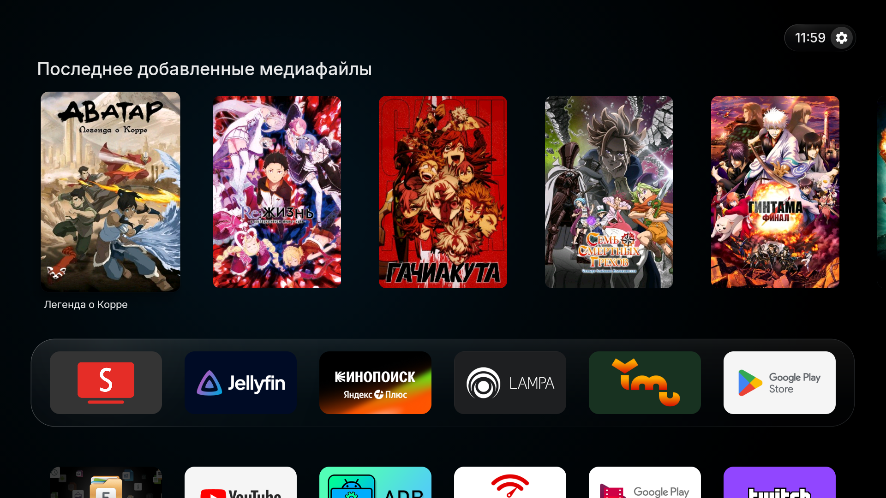
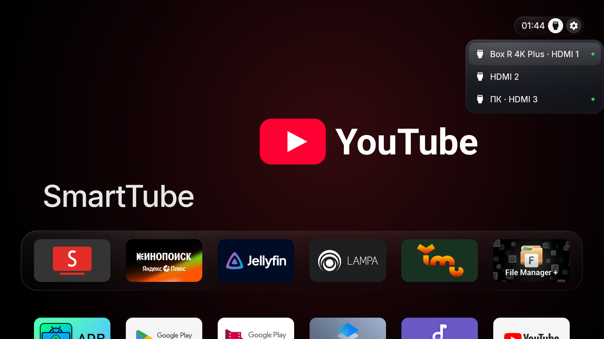

# PeachOS TV


**Любимые приложения, постеры и ничего лишнего.**

PeachOS TV — минималистичный лаунчер для Android TV и Google TV: док приложений, крупные постеры, мягкое стекло и управление обычным пультом. Меняется главный экран; приложения и подписки остаются на месте.

[Скачать APK](https://github.com/BrainDeLook/peachos-tv/releases/latest) · [English](README.md)

> Раньше проект назывался **CleanYourTV + Art**. Можно обновляться поверх: пакет и сертификат подписи сохранены. Несмотря на OS в названии, это лаунчер, а не новая операционная система.

## Главный экран



- Источник карточек выбирается отдельно для каждого приложения: все карточки Android TV, продолжение просмотра, история Lampa или конкретный канал.
- Пять крупных портретных постеров; горизонтальные и квадратные превью сохраняют свои пропорции. Подпись видна только у выбранного постера.
- Быстрое увеличение выбранной плитки с лёгкой пружиной, мягкий блик, компактные часы и настройки. Под доком виден край следующего ряда приложений.
- Мягкие звуки листания, открытия приложения и возврата на главный экран, заранее загруженные без задержки запуска. Отключаются через «Настройки лаунчера → Звуки интерфейса».
- Лёгкое отключаемое стекло. Панель управления использует один небольшой размытый снимок при открытии, без постоянного захвата экрана.
- Компактная панель управления: быстрые настройки, состояние сети, доступные входы телевизора и найденные VPN-клиенты. Раскрывается из кнопки часов и возвращается в том же окне, без переключения окон при закрытии.
- Порядок приложений и состав дока можно менять с пульта.
- При пустом списке остаётся название приложения. Когда карточки выключены, можно использовать фон из метаданных или цветное свечение; YouTube и SmartTube по умолчанию имеют статичный фон.

## Источники на телевизорах



На устройствах с доступными ТВ-входами откройте шестерёнку и выберите вкладку **«Источники»**. На приставках без таких входов вкладка скрыта. Зелёная точка означает подключение по данным телевизора: одновременно могут быть подключены несколько HDMI.

Названия CEC-устройств сохраняются. На поддерживаемой прошивке TCL учитывается подтверждённое подключение HDMI-порта, если единственное CEC-устройство ошибочно сообщает standby. Штатная кнопка Input пульта продолжает работать как раньше.

## Управление

| Действие | Кнопка |
| --- | --- |
| Из дока к постерам | Вверх |
| Листать постеры | Влево / Вправо |
| Открыть карточку в приложении | OK |
| Вернуться в док | Вниз / Назад |
| Панель управления | Нажать OK на шестерёнке |
| Настройки лаунчера | Отдельная кнопка в панели; удержание шестерёнки, если включено |
| Выбор источников карточек | Меню лаунчера → Верхний ряд |
| Порядок приложений и состав дока | Меню лаунчера → Изменить порядок / Изменить док |

Приложение должно публиковать карточки через Android TV Preview / Watch Next. История Lampa берётся из её канала истории. Частные базы приложений не читаются, root не нужен. Если приложение не публикует карточки или временно очищает канал при обновлении, ряд может быть пустым.

В панели также доступны переходы к системным настройкам, приложениям, Bluetooth, доступности, поиску при его наличии и экрану часов. VPN открывается в найденном клиенте или системных настройках: приватные профили другого приложения лаунчеру недоступны. Для кнопки **«Режим сна»** нужны Android 9+ и включённый необязательный помощник доступности **«PeachOS TV · Сон»**. Он не читает экран и не перехватывает кнопки пульта. Штатная кнопка питания работает без него.

### Кнопка настроек на пульте

Начиная с **1.5.3**, можно открывать нашу панель управления удержанием физической кнопки Settings вместо обычных настроек Android.

1. Откройте **Настройки лаунчера → Удержание Settings: контрольная панель** и включите опцию.
2. Для работы поверх других приложений включите службу **PeachOS TV · Кнопки пульта** в специальных возможностях Android. Строка с пояснением под опцией открывает этот раздел и показывает состояние службы. До версии 1.5.4 она называлась «Кнопка «Домой»».
3. Если кнопка не распознаётся, выберите **Кнопка Settings** и нажмите свою кнопку настроек в течение 15 секунд. Лаунчер запомнит её код; пункт «По умолчанию» сбросит назначение. Кнопки навигации, громкости, питания и Home назначить нельзя.
4. Проверьте кнопку Settings и удержание громкости на своём пульте.

При включённой опции **короткое нажатие ничего не делает**, а удержание открывает панель один раз, без повторного действия при отпускании. Верхняя шестерёнка исключена из навигации: Назад из панели возвращает последнюю выбранную иконку приложения.

По умолчанию опция выключена. После её отключения верхняя шестерёнка доступна стрелками, OK открывает панель, Назад из панели возвращает фокус на шестерёнку.

Отдельная опция **«Настройки по удержанию шестерёнки»** управляет быстрым входом в настройки лаунчера: удержанием OK на верхней шестерёнке или на вкладке-шестерёнке внутри панели, а также повторным удержанием Settings в открытой панели. По умолчанию включена. Если её выключить, эти удержания ничего не делают; отдельная кнопка настроек лаунчера в панели остаётся доступна.

Работа зависит от прошивки и кода кнопки: некоторые устройства резервируют Settings. Для службы должна быть разрешена фильтрация клавиш в конфигурации устройства (`key_filter`). На отдельных TCL она может нарушать повтор громкости при удержании; в таком случае отключите службу и пользуйтесь экранной шестерёнкой. Помощник сна — отдельная служба, для этой функции он не нужен.

## Установка и обновление

Нужен **Android TV / Google TV 8.0+ (API 26)**. APK не предназначен для Samsung Tizen и LG webOS.

1. Скачайте `PeachOS-TV.apk` из [последнего релиза](https://github.com/BrainDeLook/peachos-tv/releases/latest).
2. Установите на телевизор или приставку и откройте **PeachOS TV**.
3. Назначьте главным экраном в системных настройках, если прошивка это разрешает.

Через ADB:

```sh
adb -s <device> install -r -g PeachOS-TV.apk
adb -s <device> shell am start -n com.gathin.tvhome.backdrops/com.gathin.tvhome.MainActivity
```

После проверки запуска и пульта можно назначить Home:

```sh
adb -s <device> shell cmd package set-home-activity com.gathin.tvhome.backdrops/com.gathin.tvhome.MainActivity
```

Команды не очищают систему и не отключают заводской лаунчер. Некоторые прошивки ограничивают смену Home. Сохраните штатный главный экран, чтобы при необходимости выбрать его обратно в системных настройках.

**Обновление:** устанавливайте новый подписанный APK поверх старого, не удаляя приложение. Настройки сохранятся. Пакет по-прежнему `com.gathin.tvhome.backdrops`, в том числе при переходе с CleanYourTV + Art. Оригинальный `com.gathin.tvhome` может оставаться рядом.

## Данные и сеть

Лаунчеру не нужны аккаунт и API-ключ. Картинки загружаются по адресам, опубликованным приложениями. При включённых фонах из метаданных названия фильмов могут передаваться Stremio/Cinemeta для поиска изображений. Ссылки Lampa на TMDB переводятся с HTTP на HTTPS.

Когда выбран источник карточек, полноэкранные метаданные этого приложения отключены. Кэш декодированных миниатюр ограничен 2 МиБ, дисковый — 32 МиБ; картинки загружает один фоновый поток. Шрифт Inter хранится локально.

На скриншотах показана реальная установка. Логотипы приложений и изображения фильмов/сериалов принадлежат их владельцам. Лаунчер не включает подписки или видеоконтент.

## Сборка

Нужны **JDK 17**, **Android SDK Platform 34**, **Build Tools 34.0.0**. Wrapper использует **Gradle 8.9**. Задайте `JAVA_HOME` и `ANDROID_HOME`.

```sh
cd launcher
./gradlew --no-daemon testReleaseUnitTest lintRelease assembleRelease
```

В Windows используйте `gradlew.bat`. APK: `launcher/app/build/outputs/apk/release/app-release.apk`.

Готовые релизы сохраняют исходный локальный debug-сертификат проекта для совместимости обновлений. **Приватный ключ в репозиторий не включён.** Сборка с другим ключом не установится поверх релиза. Только если исходный ключ уже есть у вас, задайте `ANDROID_USER_HOME` на каталог с этим `debug.keystore`.

## Что проверено

- **Homatics Box R 4K Plus / Android 12:** док и сетка, портретные и горизонтальные карточки, источники истории, открытие карточек, возврат Home и отсутствие кнопки источников без HDMI-входов.
- **TCL Smart TV Pro / Android 12:** компактное меню входов, зелёные индикаторы, открытие HDMI 1 и прежние действия короткого/длинного нажатия шестерёнки.

248 unit-тестов проходят; lint release — без ошибок. Поведение пульта и ограничения зависят от прошивки; ровные 60 кадров на всех устройствах не гарантируются. Первый переход или открытие панели после холодного запуска всё ещё могут занимать больше времени, чем последующие.

## Благодарности и лицензии

Основа — [CleanYourTV](https://github.com/Gathin23/cleanyourtv) 2.7, commit `ab7a89e7543f2ef12aac0fa66a4d58c7f4452781`. Работа с метаданными и фонами адаптирована из [Vibe Launcher](https://github.com/maydings/vibe-launcher) v1.9.3, commit `fe00ad13730146def04275967e1df4b8365b670e`.

- Код — MIT: [LICENSE](LICENSE), [CleanYourTV](LICENSE-CleanYourTV), [Vibe Launcher](LICENSE-VibeLauncher).
- [Inter 4.1](https://github.com/rsms/inter/releases/tag/v4.1) — [SIL OFL 1.1](launcher/FONT-LICENSE-INTER.txt). Исходные ресурсы Outfit сохраняют [OFL](launcher/FONT-LICENSE-OFL.txt).
- Собственный персиковый знак экрана и материалы оформления PeachOS TV распространяются под MIT этого репозитория.

Проект не связан с Apple, Google, одноимённым Linux-проектом peachOS и приложениями на скриншотах. Логотипы Apple, шрифты SF и SF Symbols не используются как фирменные ресурсы PeachOS TV.
